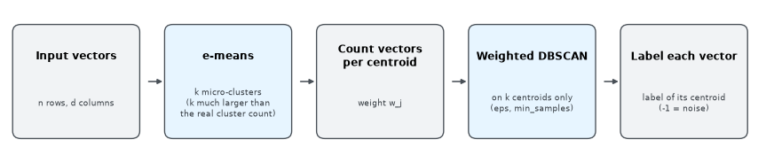
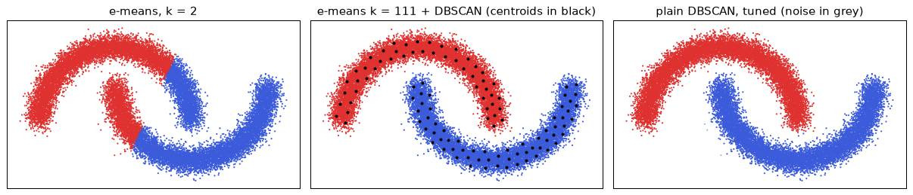
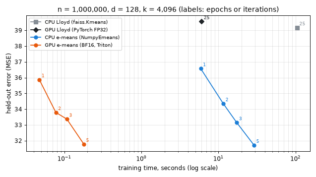

# emeans-dbscan

This repository combines [e-means](https://github.com/facebookresearch/faiss/tree/main/contrib/e_means) (faiss 1.16.0) with DBSCAN to find clusters of any shape. It uses Optuna to tune the method on the two-moons dataset. It also measures e-means and Lloyd k-means on a GPU and on a CPU.

The full article is in [`blog-post.md`](blog-post.md). [`blog-post.html`](blog-post.html) is the same article as one HTML page with the images embedded.



## Method

1. Run e-means with a k that is much larger than the number of real clusters.
2. Count the vectors in each micro-cluster.
3. Run DBSCAN on the centroids, with each centroid weighted by its count.
4. Give each vector the DBSCAN label of its centroid. Label -1 is noise.

## Results

**Two moons** (20,000 vectors, noise 0.08, 150 Optuna trials per method; scored on a held-out sample):

| Method | Best settings | ARI |
|---|---|---|
| e-means, k = 2 | none | 0.2544 |
| e-means + DBSCAN | k = 111, eps = 0.164, min_pts = 74 | 0.9998 |
| Plain DBSCAN, tuned | eps = 0.124, min_samples = 56 | 0.9991 |



**GPU and CPU** (synthetic Gaussian mixture, d = 128, k = 4,096, n = 1,000,000; RTX A4000 and Xeon E5-1620 v3):

| Method | Training time | Held-out error |
|---|---|---|
| CPU Lloyd (`faiss.Kmeans`), 25 epochs | 104.8 s | 39.17 |
| GPU Lloyd (PyTorch FP32), 25 epochs | 6.02 s | 39.56 |
| CPU e-means, 5 epochs | 28.96 s | 31.72 |
| GPU e-means (BF16, Triton), 5 epochs | 0.179 s | 31.78 |



Limits: the benchmark data is synthetic, the test uses one seed, and the CPU is from 2014. Read Part 6 and Part 7 of the article for all the limits.

## Files

| File | Purpose |
|---|---|
| `moons_emeans_dbscan.py` | Two-moons experiment. Writes `results.json` and `img/moons.jpg`. |
| `bench_gpu_cpu.py` | GPU and CPU benchmark. Writes `bench_results.json`. |
| `make_bench_figures.py` | Benchmark figures in `img/`, from `bench_results.json`. |
| `make_pipeline_figure.py` | Pipeline diagram `img/pipeline.png`. |
| `build_html.py` | Builds `blog-post.html` and `blogger-body.html` from `blog-post.md`. |
| `results.json`, `bench_results.json`, `bench.log` | Recorded results. |
| `tasks/todo.md` | Work plan. |

## Run

Requirements: [`uv`](https://docs.astral.sh/uv/) for the local scripts. Each script declares its dependencies inline.

Two-moons experiment (about 40 s on a laptop CPU):

```sh
uv run --python 3.12 moons_emeans_dbscan.py
```

GPU and CPU benchmark (Linux with an NVIDIA GPU, Ampere or newer; about 40 minutes):

```sh
python3 -m venv .venv
.venv/bin/pip install faiss-cpu==1.16.0 torch numpy
.venv/bin/python bench_gpu_cpu.py --out bench_results.json
```

Figures and HTML:

```sh
uv run --python 3.12 make_bench_figures.py
uv run --python 3.12 make_pipeline_figure.py
uv run --python 3.12 build_html.py
```

## Note on faiss versions

faiss 1.16.0 uses mass-based cluster revival and turns revival off when d ≤ 2. The removal-cost revival of faiss commit `16a95d6` is on the faiss main branch only. All results here use faiss 1.16.0.
