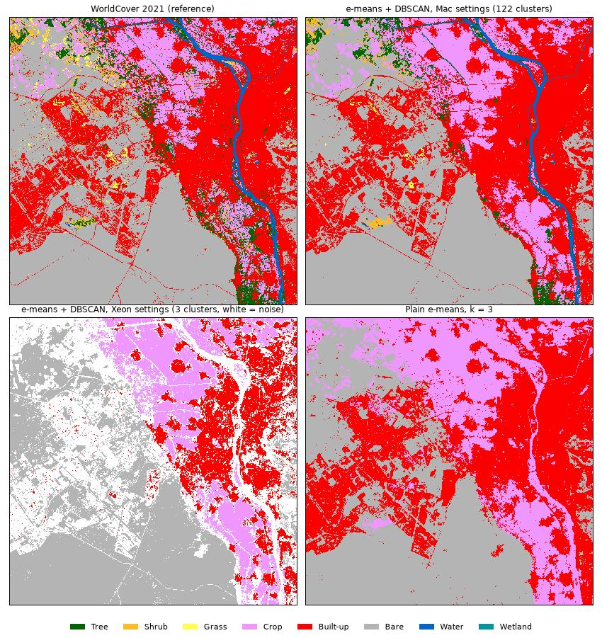

# emeans-dbscan

This repository combines [e-means](https://github.com/facebookresearch/faiss/tree/main/contrib/e_means) (faiss 1.16.0) with DBSCAN to find clusters of any shape. It uses Optuna to tune the method on the two-moons dataset. It also measures e-means and Lloyd k-means on a GPU and on a CPU.

The full article is in [`blog-post.md`](blog-post.md). [`blog-post.html`](blog-post.html) is the same article as one HTML page with the images embedded. [`explainer.html`](explainer.html) is a short technical description for a new reader.


## Method

1. Run e-means with a k that is much larger than the number of real clusters.
2. Count the vectors in each micro-cluster.
3. Run DBSCAN on the centroids, with each centroid weighted by its count.
4. Give each vector the DBSCAN label of its centroid. Label -1 is noise.

## Results

**Two moons** (20,000 vectors, noise 0.08, 150 Optuna trials per method; scored on a held-out sample):

| Method | Best settings | ARI |
|---|---|---|
| e-means, k = 2 | none | 0.2544 |
| e-means + DBSCAN | k = 111, eps = 0.164, min_pts = 74 | 0.9998 |
| Plain DBSCAN, tuned | eps = 0.124, min_samples = 56 | 0.9991 |


**GPU and CPU** (synthetic Gaussian mixture, d = 128, k = 4,096, n = 1,000,000; RTX A4000 and Xeon E5-1620 v3):

| Method | Training time | Held-out error |
|---|---|---|
| CPU Lloyd (`faiss.Kmeans`), 25 epochs | 104.8 s | 39.17 |
| GPU Lloyd (PyTorch FP32), 25 epochs | 6.02 s | 39.56 |
| CPU e-means, 5 epochs | 28.96 s | 31.72 |
| GPU e-means (BF16, Triton), 5 epochs | 0.179 s | 31.78 |


**Cairo, real AlphaEarth embeddings** (4,096 × 4,096 pixels, 16,777,216 vectors, d = 64; land ARI against ESA WorldCover 2021; tuned on a separate window):

| Method | Tune land ARI | Test land ARI |
|---|---|---|
| e-means + DBSCAN, Mac settings (k = 199) | 0.812 | 0.353 |
| e-means + DBSCAN, GPU settings (k = 823) | 0.785 | 0.307 |
| e-means + DBSCAN, Xeon settings (k = 7,393) | 0.808 | 0.494 |
| Plain DBSCAN, 320,000 vectors (Mac / xeon settings) | 0.802 / 0.782 | 0.493 / 0.456 |
| e-means, k = 3, best of ten seeds by objective | 0.715 | **0.666** |

The combined method did not beat plain e-means with k = 3 on this test window. The tune window selected k = 3 on all three backends. With k = 3, the CPU (2 of 10 seeds) and the GPU (1 of 10 seeds) sometimes find a bad solution with land ARI 0.365. It has a lower objective, so it can be rejected without labels. The k = 2 to 16 sweep was added after the first results.



Limits: the benchmark data is synthetic, the test uses one seed, and the CPU is from 2014. Read Part 6, Part 7 and Part 8 of the article for all the limits.

## Files

| File | Purpose |
|---|---|
| `moons_emeans_dbscan.py` | Two-moons experiment. Writes `results.json` and `img/moons.jpg`. |
| `bench_gpu_cpu.py` | GPU and CPU benchmark. Writes `bench_results.json`. |
| `aef_fetch.py` | Downloads the AEF embeddings and WorldCover labels for Cairo into `data/cairo/`. |
| `aef_cluster.py` | Cairo experiment: combined method, Optuna, plain DBSCAN. Writes `out/`. |
| `aef_kmeans.py` | Plain e-means: k sweep on the tune window, then the test window. |
| `aef_k3_seeds.py` | Plain e-means with k = 3, ten seeds, with the objective. |
| `aef_sensitivity.py` | Best combined settings, three seeds each, on the GPU. |
| `test_aef_cluster.py` | Tests of the combined method, the `min_pts` scaling and the result folders. Needs no data. |
| `make_cairo_figure.py` | Cairo map `img/cairo_map.jpg`. |
| `make_bench_figures.py` | Benchmark figures in `img/`, from `bench_results.json`. |
| `make_pipeline_figure.py` | Pipeline diagram `img/pipeline.png`. |
| `build_html.py` | Builds `blog-post.html` and `blogger-body.html` from `blog-post.md`. |
| `explainer.html` | Short technical description of the project. One HTML page with the images embedded. |
| `results.json`, `bench_results.json`, `bench.log` | Recorded results. |

## Run

Requirements: [`uv`](https://docs.astral.sh/uv/) for the local scripts. Each script declares its dependencies inline.

Two-moons experiment (about 40 s on a laptop CPU):

```sh
uv run --python 3.12 moons_emeans_dbscan.py
```

GPU and CPU benchmark (Linux with an NVIDIA GPU, Ampere or newer; about 40 minutes):

```sh
python3 -m venv .venv
.venv/bin/pip install faiss-cpu==1.16.0 torch numpy
.venv/bin/python bench_gpu_cpu.py --out bench_results.json
```

Figures and HTML:

```sh
uv run --python 3.12 make_bench_figures.py
uv run --python 3.12 make_pipeline_figure.py
uv run --python 3.12 build_html.py
```

Cairo test: see Part 11 of the article for the steps. Each run needs a new `--tag`: the scripts never overwrite a folder in `out/`.

```sh
uv run --python 3.12 test_aef_cluster.py
```

## e-means explorer (web app)

`app/` is a single-page app that runs e-means in the browser on the Cairo embeddings. It uses the ArcGIS Maps SDK for JavaScript 5.2 web components and Calcite from the Esri CDN. There is no build step and no framework.

- Set k (2 to 64), the epochs, the seed and the number of training pixels. Run and stop. The map redraws after each epoch.
- Compare the clusters with WorldCover (swipe). Colour by cluster or by the most frequent class.
- The map redraw is off by default above k = 16, because it labels every pixel after each epoch.
- Select a cluster to highlight it. Click a pixel to see its nearest centroids.
- Each run is listed with its mean cosine and land ARI. Run k = 3 with seeds 1 to 4: two solutions show up.

The embeddings are a nearest-pixel sample on a 1,024 × 1,024 grid (about 1 million pixels per window, 65 MB).

```sh
uv run --python 3.12 app/prepare_data.py            # needs data/cairo/ from aef_fetch.py
python3 -m http.server 8123 -d app                  # open http://localhost:8123
node --test app/test/*.mjs                          # tests; the comparison with faiss is skipped without data
uv run --python 3.12 app/test/parity_faiss.py       # makes the faiss reference results for that comparison
```

The port follows faiss 1.16.0, including the NumPy random numbers. Without cluster revival, the labels match faiss exactly for the same seed. With revival, FP32 rounding decides some labels, and faiss itself is equally sensitive.

## Note on faiss versions

faiss 1.16.0 uses mass-based cluster revival and turns revival off when d ≤ 2. The removal-cost revival of faiss commit `16a95d6` is on the faiss main branch only. All results here use faiss 1.16.0.
