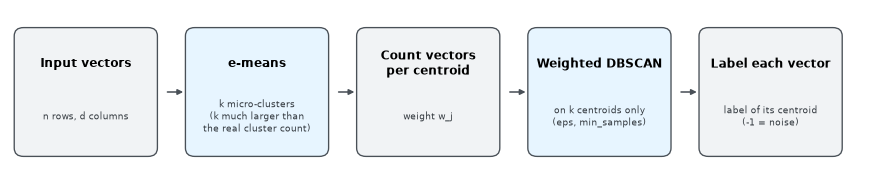
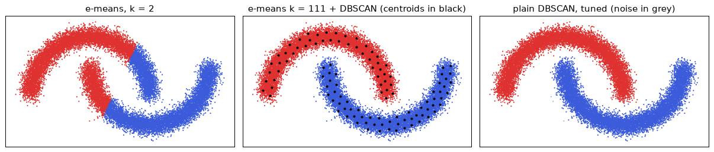
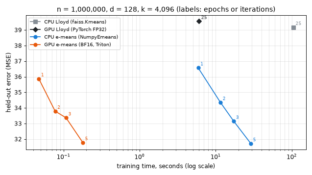
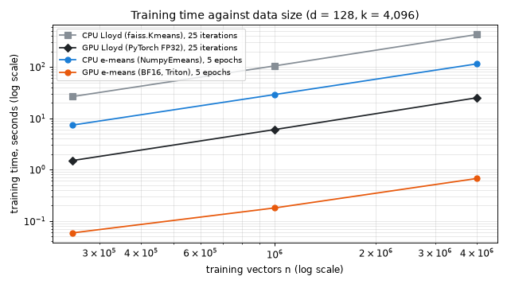

# e-means meets DBSCAN: fast micro-clusters, clusters of any shape, tuned by Optuna, and timed on a GPU

## Summary

This article has six parts:

1. It gives the history of k-means and explains how e-means changes it.
2. It shows a method that combines e-means with DBSCAN. The method finds clusters of any shape.
3. It uses Optuna to tune the method on the two-moons dataset.
4. It measures e-means on a GPU and on a CPU.
5. It compares what the press says about e-means with the faiss source code.
6. It describes PISCES, a method that claims to improve e-means.

The main results are these:

- On two moons, the combined method gets an adjusted Rand index (ARI) of 0.9998. Plain DBSCAN, tuned with the same budget, gets 0.9991.
- On a synthetic Gaussian mixture with 1,000,000 vectors, GPU e-means trains in 0.18 s. CPU Lloyd k-means trains in 104.8 s. e-means also has 19% lower error.
- The GPU is about 162× faster than the CPU for e-means. The GPU is only 17.4× faster than the CPU for Lloyd.

## Terms

This article uses these terms with one meaning each:

- **Vector**: one row of the data.
- **Centroid**: one of the k points that k-means puts in the data.
- **Cluster**: the set of vectors that have the same nearest centroid. For DBSCAN, a cluster is a set of connected dense vectors.
- **Epoch**: one pass over all the vectors. For Lloyd's algorithm, one iteration is one epoch.
- **Error**: the mean squared distance from each held-out vector to its nearest centroid. Lower is better.
- **ARI**: adjusted Rand index. It compares a clustering with the true labels. 1.0 is a perfect match. 0 is the same as random labels.

## Part 1: The history of k-means

The k-means problem has one goal. Put k centroids in the data. Make the sum of squared distances from each vector to its nearest centroid as small as possible.

- **Lloyd's algorithm (1957, published 1982).** Stuart Lloyd wrote this method at Bell Labs. Each epoch has two steps. First, assign each vector to its nearest centroid. Then move each centroid to the mean of its vectors. `faiss.Kmeans` does 25 epochs by default.
- **MacQueen (1967).** James MacQueen gave the method its name. His method updates a centroid after each vector. It does not wait for a full epoch.
- **Mini-batch k-means (Sculley, 2010).** This method updates the centroids from small random batches of vectors. Each step is fast. But you must tune the batch size and the step size for each dataset. The method also makes "dead" centroids that have no vectors. It can also make clusters of very different sizes.

For many years, engineers had two choices. Lloyd's algorithm is reliable but slow. Mini-batch k-means is fast but needs tuning.

## Part 2: How e-means works

Meta FAIR and École des Ponts released e-means in faiss 1.16.0 in November 2026. The paper is Bessa et al., [arXiv 2611.09501](https://arxiv.org/abs/2611.09501). e-means keeps mini-batch updates. It removes the tuning. The faiss source code shows six parts:

1. **Exponential moving average (EMA).** Each centroid has a mass and a sum. Each batch updates them with an EMA step. The effect of early, bad assignments becomes smaller over time.
2. **Cosine schedule.** The EMA step starts at a value `alpha0`. The step becomes smaller on a cosine curve until the last epoch.
3. **Scaling laws.** The authors fit formulas for the batch size B and the start step `alpha0`. The inputs are n (the number of vectors), k and T (the number of epochs). An example is B = 0.035 · k<sup>0.135</sup> · n<sup>0.876</sup> · T<sup>0.813</sup>. You set only `nepochs`. The default is 5.
4. **Cluster revival.** Some centroids have almost no vectors, or do not help the result. e-means moves each of these centroids to split a busy donor cluster. The rule depends on the version:
   - **faiss 1.16.0 (the PyPI release)**: e-means revives a centroid when its mass is less than 0.1 times the mean mass. It selects donors in proportion to their mass. When d ≤ 2, revival is off.
   - **faiss main, commit `16a95d6` (22 November 2026)**: e-means selects centroids by their removal cost. It splits each donor into two parts along the donor's longest axis. This change is not in a release yet.
5. **Closing step.** After the last epoch, e-means moves each centroid to the exact mean of its vectors from the last epoch. This step costs almost no time.
6. **Fast kernels.** On NVIDIA GPUs, Triton and CuTe kernels calculate the distances and the nearest centroid in one step. On a CPU, e-means uses `faiss.knn`.

The faiss benchmark README gives the authors' results on 1M to 100M real embeddings:

- e-means needs 1.4 to 2.6 epochs to reach the error of Flash-KMeans after 25 iterations.
- At that error, e-means is 9.5× to 36× faster on the GPU.
- After 25 epochs, the error of e-means is 0.5% to 1.1% lower than the error of faiss k-means after 25 iterations.

This code trains e-means on a CPU:

```python
from faiss.contrib.e_means import NumpyEmeans

em = NumpyEmeans(d, k)            # 5 epochs by default
centroids, labels = em.train(x)   # x: float32 NumPy array, shape (n, d)
distances, labels = em.assign(x)  # exact nearest final centroid
```

## Part 3: The limits of e-means, and DBSCAN

e-means solves the k-means problem. Thus it has the limits of k-means:

- You must set k before you start.
- Each cluster is a convex cell. A curved cluster or a ring cluster becomes many parts.
- e-means puts each vector in a cluster. It has no "noise" label.

DBSCAN (Ester, Kriegel, Sander and Xu, 1996) has different properties:

- A vector is a core vector when at least `min_samples` vectors are within the distance `eps`.
- Core vectors that are within `eps` of each other are in the same cluster.
- DBSCAN labels a vector as noise when no cluster reaches it.
- DBSCAN finds the number of clusters. It follows clusters of any shape.

DBSCAN also has limits. It does a neighbour search around each vector. This search is slow when n is large. It is also difficult to select a good value for `eps`.

## Part 4: The combined method

The method uses e-means to make a summary of the data. Then it runs DBSCAN on the summary. BIRCH and DenStream use the same idea.



The method has four steps:

1. Run e-means with a large k. Use a k that is much larger than the number of real clusters. Each centroid is now the center of a small cell. This article calls these cells micro-clusters.
2. Count the vectors in each micro-cluster.
3. Run DBSCAN on the centroids. Give each centroid a weight that is equal to its count. Thus `min_samples` counts vectors, not centroids.
4. Give each vector the DBSCAN label of its centroid.

DBSCAN sees k centroids, not n vectors. e-means does the work on all n vectors. e-means is fast at this work.

```python
import numpy as np
from faiss.contrib.e_means import NumpyEmeans
from sklearn.cluster import DBSCAN


def emeans_dbscan(x, k, eps, min_pts, seed=1234):
    em = NumpyEmeans(x.shape[1], k, seed=seed)
    C, _ = em.train(x)
    _, micro = em.assign(x)                 # nearest final centroid
    micro = micro.ravel()
    w = np.bincount(micro, minlength=k)     # vectors per micro-cluster
    keep = w > 0
    lab_c = np.full(k, -1)
    lab_c[keep] = DBSCAN(eps=eps, min_samples=min_pts).fit(
        C[keep], sample_weight=w[keep]).labels_
    return lab_c[micro], C                  # -1 means noise
```

## Part 5: Tuning with Optuna

The method has three settings: k, `eps` and `min_pts`. The settings have an effect on each other. A larger k puts the centroids nearer to each other. Then a smaller `eps` can connect them. [Optuna](https://optuna.org) searches all three settings. It uses its default TPE sampler.

```python
import optuna
from sklearn.metrics import adjusted_rand_score as ari


def objective(trial):
    k = trial.suggest_int("k", 8, 1024, log=True)
    eps = trial.suggest_float("eps", 0.01, 0.5, log=True)
    min_pts = trial.suggest_int("min_pts", 1, 2000, log=True)
    labels, _ = emeans_dbscan(x_tune, k, eps, min_pts)
    return ari(y_tune, labels)


study = optuna.create_study(direction="maximize",
                            sampler=optuna.samplers.TPESampler(seed=0))
study.optimize(objective, n_trials=150)
```

## Part 6: The two-moons experiment

### Setup

- The data is scikit-learn's `make_moons`: 20,000 vectors in 2D, noise 0.08.
- The two clusters are curved. They hook into each other. No straight line can divide them.
- Optuna tunes on one sample (seed 0). The best settings are then scored on a second sample (seed 1). Optuna does not see the second sample.
- Plain DBSCAN gets the same budget: 150 Optuna trials over the same `eps` and `min_pts` ranges.
- The test machine is a MacBook (Apple silicon) CPU.
- The software is faiss-cpu 1.16.0. In this version, e-means does no cluster revival when d ≤ 2. Thus the two-moons runs have no revival.

### Results



| Method | Best settings | ARI on held-out sample | Trials with ARI ≥ 0.99 | Time on held-out sample |
|---|---|---|---|---|
| e-means, k = 2 | none | 0.2544 | n/a | 0.10 s |
| e-means + DBSCAN | k = 111, eps = 0.164, min_pts = 74 | **0.9998** | 63% | 0.11 s |
| Plain DBSCAN | eps = 0.124, min_samples = 56 | 0.9991 | 41% | 0.13 s |

### How the combined method finds the moons

1. **e-means alone cannot find the moons.** With k = 2, e-means makes one straight boundary. The boundary cuts each moon into two parts. The ARI is 0.25.
2. **With k = 111, the centroids follow the shape.** The centroids make two chains, one chain along the middle of each moon. Each micro-cluster is small. Thus no micro-cluster crosses the gap between the moons.
3. **DBSCAN connects each chain.** With `eps` = 0.16, each centroid reaches its neighbours on the same moon. It does not reach the centroids on the other moon.
4. **The weights make core points.** Each busy micro-cluster has a large weight. Thus each centroid is a core point, and each chain becomes one cluster.
5. **The result is correct.** The method finds exactly 2 clusters and 0% noise.
6. **The settings work on new data.** The ARI is 1.0000 on the tuning sample and 0.9998 on the held-out sample.

### What this experiment does not show

- **Plain DBSCAN is equally good at this size.** Tuned DBSCAN gets ARI 0.9991 in about the same time. With 20,000 vectors in 2D, the neighbour search of DBSCAN is fast.
- **The combined method was easier to tune.** 63% of its trials got ARI ≥ 0.99. For plain DBSCAN, 41% of the trials did. This result comes from one search on one dataset. It is not a general result.
- **The speed advantage needs a large n.** The time of DBSCAN increases with n. The combined method runs DBSCAN on only k centroids. This experiment is too small to show the advantage.
- **Optuna used the true labels.** Real data has no labels. For real data, use a score that needs no labels, for example DBCV. You can also check that the clusters stay the same for different seeds.
- **High dimensions are more difficult.** In a high-dimensional space, the distances between vectors become almost equal. Then a fixed `eps` is less useful. HDBSCAN on the centroids needs no `eps`. It is a good next test.

## Part 7: GPU and CPU benchmark

### Why this dataset

The benchmark uses a synthetic Gaussian mixture. These are the reasons:

- The data looks like an embedding search problem: d = 128 and k = 4,096. This is the work that e-means is for.
- The true centers are known. Thus the benchmark can calculate the best possible error.
- The data is generated with a fixed seed. Any person can make the same data again.
- 4,000,000 vectors use 2 GB in FP32. This fits in the 16 GB of the GPU.
- n · k goes from 1 · 10<sup>9</sup> to 1.6 · 10<sup>10</sup>. The faiss README recommends a GPU when n · k is more than 10<sup>10</sup>.

### Setup

- **Data**: 4,096 Gaussian clusters in d = 128. The centers are random normal vectors. The cluster spread has a log-normal distribution (median 0.37). The cluster sizes have a Dirichlet distribution, so some clusters are much larger than others.
- **Sizes**: n = 250,000, 1,000,000 and 4,000,000 training vectors. 100,000 held-out vectors from the same mixture.
- **Best possible error**: the error of the true centers is 23.83.
- **Machine**: `xeon`. GPU: NVIDIA RTX A4000 (16 GB, Ampere, sm_86). CPU: Intel Xeon E5-1620 v3 (4 cores, 8 threads, 2014). 31 GB RAM.
- **Software**: faiss-cpu 1.16.0, PyTorch 2.14.1 (CUDA 13.0), Triton 3.8.0, Python 3.10. faiss 1.16.0 uses the mass-based revival rule (see Part 2). The newer removal-cost rule is not in this test.
- **Methods**: all methods fit k = 4,096 centroids to the same vectors with seed 1234.
  - CPU Lloyd: `faiss.Kmeans`, 25 epochs, 8 threads, no subsampling.
  - GPU Lloyd: a plain PyTorch Lloyd in FP32, 25 epochs. It finds the exact nearest centroid.
  - CPU e-means: `NumpyEmeans`, 1, 2, 3 and 5 epochs.
  - GPU e-means: `Emeans` on a BF16 tensor, 1, 2, 3 and 5 epochs. e-means selected the Triton backend. The CuTe backend needs an H100 or H200.
- **Timing**: the clock measures training only. The data is on the GPU before the clock starts. Each GPU configuration has one untimed warm-up run, because the kernels compile on the first run. Each time is the median of 3 runs. CPU Lloyd at n = 4,000,000 has 1 run only, because one run takes 7 minutes.
- **Error**: `faiss.knn` on the CPU finds the exact nearest centroid for each held-out vector.

### Results





| n | Method | Epochs | Training time (s) | Held-out error |
|---|---|---|---|---|
| 250,000 | CPU Lloyd (faiss.Kmeans) | 25 | 26.5 | 40.68 |
| 250,000 | GPU Lloyd (PyTorch, FP32) | 25 | 1.50 | 40.83 |
| 250,000 | CPU e-means | 1 | 1.56 | 40.08 |
| 250,000 | CPU e-means | 3 | 4.44 | 34.95 |
| 250,000 | CPU e-means | 5 | 7.36 | 33.35 |
| 250,000 | GPU e-means (BF16) | 1 | 0.017 | 39.75 |
| 250,000 | GPU e-means (BF16) | 3 | 0.036 | 34.75 |
| 250,000 | GPU e-means (BF16) | 5 | 0.058 | 33.23 |
| 1,000,000 | CPU Lloyd (faiss.Kmeans) | 25 | 104.8 | 39.17 |
| 1,000,000 | GPU Lloyd (PyTorch, FP32) | 25 | 6.02 | 39.56 |
| 1,000,000 | CPU e-means | 1 | 5.88 | 36.58 |
| 1,000,000 | CPU e-means | 3 | 17.3 | 33.15 |
| 1,000,000 | CPU e-means | 5 | 29.0 | 31.72 |
| 1,000,000 | GPU e-means (BF16) | 1 | 0.047 | 35.87 |
| 1,000,000 | GPU e-means (BF16) | 3 | 0.11 | 33.37 |
| 1,000,000 | GPU e-means (BF16) | 5 | 0.18 | 31.78 |
| 4,000,000 | CPU Lloyd (faiss.Kmeans) | 25 | 427.9 | 39.35 |
| 4,000,000 | GPU Lloyd (PyTorch, FP32) | 25 | 25.1 | 39.69 |
| 4,000,000 | CPU e-means | 1 | 23.3 | 34.73 |
| 4,000,000 | CPU e-means | 3 | 69.1 | 32.38 |
| 4,000,000 | CPU e-means | 5 | 114.7 | 33.05 |
| 4,000,000 | GPU e-means (BF16) | 1 | 0.15 | 34.84 |
| 4,000,000 | GPU e-means (BF16) | 3 | 0.41 | 32.53 |
| 4,000,000 | GPU e-means (BF16) | 5 | 0.67 | 32.71 |

### Speedups

| Comparison at n = 1,000,000 | Time A (s) | Time B (s) | Speedup |
|---|---|---|---|
| Hardware, Lloyd: CPU Lloyd (A) against GPU Lloyd (B), 25 epochs each | 104.8 | 6.02 | 17.4× |
| Hardware, e-means: CPU e-means (A) against GPU e-means (B), 5 epochs each | 29.0 | 0.18 | 162× |
| Algorithm, CPU: Lloyd 25 epochs (A) against e-means 1 epoch (B) | 104.8 | 5.88 | 17.8× |
| Algorithm, GPU: Lloyd 25 epochs (A) against e-means 5 epochs (B) | 6.02 | 0.18 | 33.6× |
| Both: CPU Lloyd 25 epochs (A) against GPU e-means 1 epoch (B) | 104.8 | 0.047 | 2,215× |

### Findings

1. **The GPU helps e-means more than it helps Lloyd.** The GPU is 17.4× faster for Lloyd. It is 162× faster for e-means. The reasons: GPU e-means uses BF16 and fused Triton kernels. The GPU Lloyd in this test is plain PyTorch in FP32.
2. **One epoch of e-means is better than 25 epochs of Lloyd.** This is true at all three sizes. At n = 1,000,000, one CPU epoch takes 5.88 s and gives error 36.58. CPU Lloyd takes 104.8 s and gives error 39.17.
3. **The two GPU input types give the same error.** FP32 input and BF16 input give the same error at each budget. On CUDA, e-means converts FP32 input to BF16 for the assignment step by default. The FP32 input is 8% slower at n = 1,000,000, because of this conversion.
4. **The time increases linearly with n.** All four methods have almost straight, parallel lines on the log-log plot.
5. **More epochs did not always help.** At n = 4,000,000, 5 epochs gave a higher error than 3 epochs: 32.71 against 32.53 on the GPU. The CPU shows the same result. The test uses one seed. Thus this result can be seed noise.
6. **All methods are far from the best possible error.** The best possible error is 23.83. The best e-means result is 31.72. Lloyd stays near 39 to 40. Random start centroids put many centroids in the large clusters and too few in the small clusters.

### The limits of this benchmark

- **The data is synthetic.** The clusters are Gaussian and have very different sizes. The cluster revival of e-means helps much on this type of data. On real embeddings, the paper reports about 1% lower error, not 19%.
- **The CPU is old.** The Xeon E5-1620 v3 has 4 cores from 2014. A new server CPU with many cores makes the CPU times much smaller.
- **The GPU Lloyd is not optimized.** It uses FP32 and plain PyTorch. A BF16 Lloyd, or Flash-KMeans, is faster.
- **The test uses one seed.** The variation of the error between seeds is not measured.
- **The test does not include data transfer.** The time to copy the data to the GPU is not in the training time.

## Part 8: What the press says

Two texts from AlphaSignal describe e-means. They do not agree:

- **The web article**: "Meta's e-means Beats 25-Pass Clustering in Just 3 Passes at 45x Speedup", AlphaSignal newsroom, 6 November 2026.
- **The newsletter text**: "RAG gets a 70-year upgrade with Meta's e-means algorithm". I did not find this text on the web.

| Claim | Newsletter text | Web article | faiss repository |
|---|---|---|---|
| GPU speedup 10–45× | against Flash-KMeans | against Lloyd, at the target error | against Flash-KMeans: 9.5–36× (Table 3), 17–31× (Figure 4b) |
| CPU speedup 8–15× | against Faiss | against Lloyd | no CPU timing table |
| Epochs to reach Lloyd's error after 25 epochs | "about one tenth" | 1.2–3 | 1.4–2.6, against Flash-KMeans |
| Cluster revival | splits a large cluster | "proportional split"; dead clusters go from 26% to 0.3% | since 22 November 2026, selects by removal cost |
| Largest run | not given | 10 billion vectors, 16 million clusters, 2.5 epochs | DINO10B demos in `benchs/e_means`; I did not check the numbers |

The two AlphaSignal texts give different baselines for the same speedup numbers. The faiss repository supports "against Flash-KMeans" for the GPU, but with a maximum of 36×, not 45×. The paper can contain other numbers. I did not read the paper.

My own benchmark is not the same test. It uses a different GPU, a different baseline and synthetic data. It shows a 33.6× speedup of GPU e-means (5 epochs) against a plain GPU Lloyd (25 epochs) at n = 1,000,000.

## Part 9: PISCES, a claimed improvement

PISCES is on Hugging Face at [Nabidnur/PISCES](https://huggingface.co/Nabidnur/PISCES). The author is "Aryan". The name means "Principal-axis Informed Splitting with Consistent closing, Early revival and Sparse assignment". Its class `aries.PEmeans` is a subclass of `NumpyEmeans`. With all options off, the author says that it gives the same output as e-means.

### What PISCES changes

1. **Principal-axis split.** e-means (in the version that PISCES used) copied a donor centroid and added a very small change. PISCES puts the two new centroids at c ± sqrt(2λ<sub>1</sub>/π) · u<sub>1</sub>. Here u<sub>1</sub> is the main axis of the donor cluster, and λ<sub>1</sub> is the variance along that axis. These are the means of the two halves of a Gaussian.
2. **Donor by gain.** PISCES selects the donor cluster with the largest N · λ<sub>1</sub>. It does not select the largest cluster. The author shows that a split removes at most (2/π) · N · λ<sub>1</sub> of the error.
3. **Early revival.** PISCES revives clusters only in the first 30% of the steps.
4. **Sparse assignment.** PISCES uses an IVF index over the centroids to find the nearest centroid. This search is approximate, not exact.

The faiss main branch (commit `16a95d6`, not in a release yet) now also splits along the donor's longest axis. It uses the same Gaussian half-mean formula. When this change is in a release, the difference between the two methods becomes smaller.

### What PISCES claims

On DEEP* with 1,000,000 vectors, k = 16,384, 10 seeds, on a 4-core CPU:

| Epochs | Error change against e-means | Seeds won | Time ratio |
|---|---|---|---|
| 1 | −0.88% | 10 of 10 | 0.42× |
| 3 | −0.27% | 10 of 10 | 0.30× |
| 5 | −0.28% | 10 of 10 | 0.27× |

- On SPACEV 1M, at 3 epochs: −0.45% error, 5 of 5 seeds, 0.37× time.
- On SimSearchNet++ 1M, at 3 epochs: −0.04% error, 5 of 5 seeds, 0.34× time.
- In one e-means run at 3 epochs, 96% of the time was in the exact nearest-centroid search. This is why sparse assignment makes PISCES faster on a CPU.

### Problems with the claims

- The page is self-published. It has no peer review.
- The page gives only relative changes. It gives no absolute error values.
- The author set two rules after the main evaluation.
- One table says 3 of 10 seeds. The text says 17 of 20 runs. The page does not explain the difference.
- All runs are on a CPU. The page has no GPU result. On a GPU, the exact search of e-means is already fast (see Part 7).
- I did not run PISCES. I did not check its numbers.

## Part 10: Procedure to reproduce the results

### Two-moons experiment

1. Install `uv`.
2. Open a terminal in the project folder.
3. Run `uv run --python 3.12 moons_emeans_dbscan.py`.
4. Read the results in `results.json`.
5. Look at the figure in `img/moons.jpg`.

The run takes about 40 seconds on a laptop CPU.

### GPU and CPU benchmark

1. Get a Linux computer with an NVIDIA GPU (Ampere or newer).
2. Make a virtual environment: `python3 -m venv .venv`.
3. Install the packages: `.venv/bin/pip install faiss-cpu==1.16.0 torch numpy`.
4. Copy `bench_gpu_cpu.py` to the computer.
5. Run `.venv/bin/python bench_gpu_cpu.py --out bench_results.json`.
6. Copy `bench_results.json` back to the project folder.
7. Run `uv run --python 3.12 make_bench_figures.py`.

The full benchmark takes about 40 minutes on `xeon`. CPU Lloyd uses most of this time.

## References

- S. Lloyd, "Least squares quantization in PCM", IEEE Transactions on Information Theory, 1982 (Bell Labs report, 1957).
- J. MacQueen, "Some methods for classification and analysis of multivariate observations", 5th Berkeley Symposium, 1967.
- D. Sculley, "Web-scale k-means clustering", WWW 2010.
- M. Ester, H.-P. Kriegel, J. Sander and X. Xu, "A density-based algorithm for discovering clusters in large spatial databases with noise", KDD 1996.
- T. Akiba, S. Sano, T. Yanase, T. Ohta and M. Koyama, "Optuna: A next-generation hyperparameter optimization framework", KDD 2019.
- S. Bessa et al., "e-means: outperforming k-means (in one-tenth the epochs)", [arXiv 2611.09501](https://arxiv.org/abs/2611.09501), 2026. Code: [faiss/contrib/e_means](https://github.com/facebookresearch/faiss/tree/main/contrib/e_means).
- AlphaSignal, "Meta's e-means Beats 25-Pass Clustering in Just 3 Passes at 45x Speedup", [alphasignal.ai](https://alphasignal.ai/news/meta-s-e-means-beats-25-pass-clustering-in-just-3-passes-at-45x-speedup), 6 November 2026.
- Aryan, "PISCES", [huggingface.co/Nabidnur/PISCES](https://huggingface.co/Nabidnur/PISCES), 2026.
